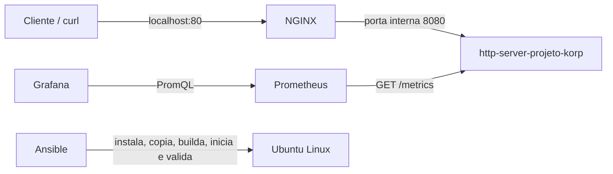

# HTTP Server Projeto Korp

Implementação completa do desafio DevOps: serviço HTTP em Go, proxy reverso NGINX, métricas Prometheus, dashboard Grafana provisionado como código e automação integral com Ansible.

## Arquitetura



Todos os containers participam da rede bridge externa `projeto-korp-network`. A aplicação expõe a porta 8080 somente dentro dessa rede; apenas o NGINX publica a aplicação na porta 80 do host.

## Requisitos atendidos

| Requisito | Implementação | Evidência |
|---|---|---|
| Serviço Go na porta 8080 | `app/main.go` | `GET /projeto-korp` |
| JSON com horário UTC dinâmico | Horário calculado dentro do handler | Teste automatizado e `curl` |
| Build e execução em container | Dockerfile multi-stage | `docker build` |
| Rede Docker bridge | `projeto-korp-network` | Ansible e `docker network inspect` |
| Aplicação sem porta no host | Apenas `expose: 8080` | Ausência de `ports` no serviço |
| NGINX oficial na porta 80 | `nginx:1.30.4-alpine3.24` | Proxy para o nome interno do serviço |
| Volume em `/etc/nginx/conf.d` | Bind mount somente leitura | Arquivo exigido no diretório |
| Disponibilidade | Série Prometheus `up` e `/healthz` | Painéis do Grafana |
| Volume de requisições | `projeto_korp_http_requests_total` | Painéis do Grafana |
| Prometheus | Scrape a cada 5 segundos | Target `http-server-projeto-korp` |
| Grafana | Datasource e dashboard versionados | Provisioning automático no startup |
| Ansible | Roles `docker` e `projeto_korp` | Um `ansible-playbook` provisiona tudo |
| Alertas | Disponibilidade, erros 5xx e latência p95 | Três regras validadas pelo `promtool` |
| Validação final | `uri`, `assert` e APIs de observabilidade | Evidências exibidas no console |
| Integração contínua | Go, Docker, Prometheus, NGINX e Ansible | Workflow GitHub Actions |

## Endpoints e interfaces

| Endereço | Uso |
|---|---|
| `http://localhost:80/projeto-korp` | Endpoint obrigatório através do NGINX |
| `http://localhost:80/healthz` | Disponibilidade da aplicação |
| `http://http-server-projeto-korp:8080/metrics` | Métricas disponíveis somente na rede Docker |
| `http://localhost:9090` | Prometheus, limitado ao loopback do host |
| `http://localhost:3000` | Grafana |

O usuário padrão do Grafana é `admin`. No fluxo Ansible, uma senha forte é gerada na primeira
execução e mantida somente em `ansible/.secrets/grafana_admin_password`, que está no `.gitignore`.

## Decisão: provisioning nativo em vez de Terraform

O Grafana suporta carregar datasources e dashboards diretamente de arquivos. Essa abordagem foi escolhida porque:

- Não exige instalar Terraform nem provider adicional.
- Não depende da API do Grafana ficar disponível antes da criação do dashboard.
- Mantém dashboard e datasource no mesmo ciclo de vida do Docker Compose.
- Funciona tanto na execução manual quanto no provisionamento Ansible.
- Permite revisar todo o conteúdo no Git e recriar o ambiente sem etapas manuais.

Os arquivos usados são:

```text
grafana/
├── dashboards/http-server-projeto-korp-dashboard.json
└── provisioning/
    ├── dashboards/dashboards.yml
    └── datasources/datasources.yml
```

O JSON não permite comentários. Por isso, cada painel possui uma propriedade `description`, e as decisões gerais estão registradas neste README.

## Execução recomendada com Ansible

### 1. Preparar o nó de controle

O Ansible deve executar em Linux, macOS ou Windows com WSL2. Para máxima fidelidade ao desafio, recomenda-se uma VM Ubuntu 24.04 LTS limpa.

Instale Ansible no nó de controle e depois a coleção declarada pelo projeto:

```bash
ansible-galaxy collection install -r ansible/requirements.yml
```

Essa etapa prepara a ferramenta de controle; o provisionamento do ambiente gerenciado continuará sendo um único comando.

O playbook gera automaticamente a senha do Grafana no nó de controle. Depois do provisionamento,
consulte-a localmente sem copiá-la para commits ou logs:

```bash
cat ansible/.secrets/grafana_admin_password
```

### 2. Definir o host

O inventário padrão provisiona a própria máquina Ubuntu:

```yaml
localhost:
  ansible_connection: local
```

Para uma VM remota, altere `ansible/inventory/hosts.yml`:

```yaml
all:
  children:
    projeto_korp:
      hosts:
        projeto-korp-vm:
          ansible_host: 192.0.2.10
          ansible_user: ubuntu
          ansible_ssh_private_key_file: ~/.ssh/projeto-korp
```

Valide o acesso antes do provisionamento:

```bash
cd ansible
ansible projeto_korp -m ping
```

### 3. Provisionar tudo com um comando

```bash
cd ansible
ansible-playbook site.yml --ask-become-pass
```

Em uma VM remota cujo usuário possui `sudo` sem senha, `--ask-become-pass` pode ser omitido.

O playbook executa os seguintes blocos:

1. Valida o Ubuntu Linux.
2. Instala Docker Engine, Buildx e Compose v2 pelo repositório oficial.
3. Copia todos os artefatos para `/opt/http-server-projeto-korp`.
4. Cria a rede bridge externa.
5. Executa testes e constrói a imagem Go.
6. Inicia aplicação, NGINX, Prometheus e Grafana.
7. Valida o JSON e o horário UTC.
8. Confirma que o target do Prometheus está `UP`.
9. Confirma que as três regras de alerta foram carregadas.
10. Valida a saúde e a conexão do datasource Prometheus no Grafana.
11. Confirma que o dashboard foi realmente provisionado.
12. Exibe as evidências no console.

## Execução manual com Docker

Este fluxo é útil para desenvolvimento; a apresentação principal deve usar Ansible.

```bash
# Copia configurações locais sem versionar credenciais reais.
cp .env.example .env

# Preencha GRAFANA_ADMIN_PASSWORD no arquivo .env antes de continuar.

# Cria a rede exigida antes do Compose, pois ela está marcada como external.
docker network inspect projeto-korp-network >/dev/null 2>&1 || docker network create --driver bridge projeto-korp-network

# O Dockerfile executa go test antes de produzir o binário final.
docker build --tag http-server-projeto-korp:1.0.0 ./app

# Inicia os quatro componentes em segundo plano.
docker compose up --detach
```

Teste obrigatório:

```bash
curl http://localhost:80/projeto-korp
```

Resposta esperada, com horário diferente a cada chamada:

```json
{
  "nome": "Projeto Korp",
  "horario": "2026-09-09T16:30:00.123456789Z"
}
```

## Dashboard e geração de tráfego

Abra `http://localhost:3000/d/http-server-projeto-korp/http-server-projeto-korp`. O dashboard já existirá na pasta **Projeto Korp**.

Gere tráfego para visualizar o contador e a taxa:

```bash
# Produz 100 chamadas válidas através do proxy reverso.
for request in $(seq 1 100); do
  curl --silent --output /dev/null http://localhost:80/projeto-korp
done
```

Painéis provisionados:

- Estado atual do serviço.
- Total de requisições.
- Latência p95.
- Disponibilidade ao longo do tempo.
- Volume de requisições por status HTTP.

## Validações úteis para a demonstração

```bash
# Confirma containers, healthcheck e portas publicadas.
docker compose ps

# Confirma que todos participam da rede criada pelo Ansible.
docker network inspect projeto-korp-network

# Valida a sintaxe carregada pelo NGINX.
docker compose exec nginx nginx -t

# Confirma que a aplicação não está publicada diretamente no host; esta chamada deve falhar.
curl http://localhost:8080/projeto-korp

# Consulta no Prometheus a mesma série usada pelo painel de disponibilidade.
curl --get --data-urlencode 'query=up{job="http-server-projeto-korp"}' http://localhost:9090/api/v1/query

# Confirma que o grupo de alertas versionado foi carregado.
curl 'http://localhost:9090/api/v1/rules?type=alert'

# Uma segunda execução comprova a idempotência da automação.
cd ansible
ansible-playbook site.yml --ask-become-pass
```

## Métricas implementadas

```text
# Volume obrigatório, particionado por método, rota conhecida e status.
projeto_korp_http_requests_total

# Histograma adicional usado para calcular latência p95.
projeto_korp_http_request_duration_seconds

# Disponibilidade gerada automaticamente pelo Prometheus para cada target.
up{job="http-server-projeto-korp"}
```

Rotas livres ou identificadores de usuário não são usados como labels, evitando crescimento descontrolado da cardinalidade.

## Alertas implementados

As regras ficam em `prometheus/rules/alerts.yml` e são carregadas automaticamente pelo Compose:

- `ProjetoKorpDown`: aplicação sem scrape por pelo menos um minuto.
- `ProjetoKorpHighErrorRate`: mais de 5% de respostas HTTP 5xx durante cinco minutos.
- `ProjetoKorpHighLatencyP95`: latência p95 acima de 500 ms durante cinco minutos.

O projeto não define um receiver externo, pois e-mail, Slack ou PagerDuty exigiriam credenciais e destinos específicos. Os alertas ficam visíveis na interface do Prometheus e prontos para integração com Alertmanager.

## Integração contínua

O workflow `.github/workflows/ci.yml` é executado em pushes para `main` e pull requests. Ele valida:

- Testes Go com detector de corrida e cobertura mínima de 50%.
- `go vet`, compilação e build da imagem final.
- Sintaxe do Docker Compose e do NGINX.
- Configuração e regras do Prometheus com `promtool`.
- JSON do dashboard Grafana.
- Sintaxe e boas práticas do Ansible com `ansible-lint`.

O Dependabot verifica semanalmente dependências Go, imagens Docker e GitHub Actions.

## Encerramento e limpeza

```bash
# Para os containers sem remover os dados de observabilidade.
docker compose down

# A opção --volumes também apaga históricos e usuários locais do Grafana.
docker compose down --volumes
```

A remoção da rede é separada porque ela é externa ao projeto Compose:

```bash
docker network rm projeto-korp-network
```

## Observações de segurança

- Senhas reais ficam em `.env` ou `ansible/.secrets/`; ambos são ignorados pelo Git.
- Em ambientes compartilhados, o arquivo local também pode ser substituído por Ansible Vault ou secret manager.
- Prometheus é publicado exclusivamente em `127.0.0.1`.
- `/metrics` não é encaminhado pelo NGINX e permanece acessível apenas na rede Docker.
- A aplicação usa imagem `scratch`, usuário sem privilégios, filesystem somente leitura e nenhuma capability Linux.
- Prometheus e Grafana removem todas as capabilities Linux; o Grafana também usa filesystem somente leitura.
- Logs dos quatro serviços possuem rotação de 10 MB e retenção máxima de três arquivos.
- Todos os serviços possuem limites explícitos de CPU, memória e quantidade de processos.
- Tags de imagens e dependências foram fixadas para tornar o resultado reproduzível.
- O socket Docker não é montado em nenhum container.
